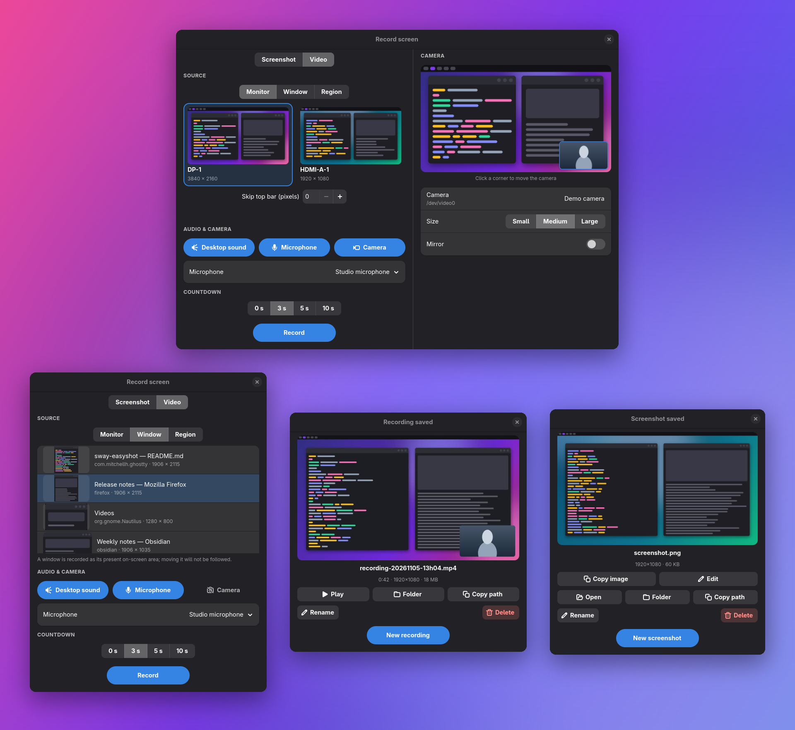

# sway-easyshot

A screenshot and screen recording utility for Sway/Wayland.



## Features

- Screenshot capture (window, screen, or selection)
- Screen recording with gpu-screen-recorder (hardware-accelerated, saved directly as MP4)
- Optional webcam picture-in-picture overlay on recordings
- Clipboard integration
- Image editing with satty
- Waybar status integration
- OBS integration
- Daemon mode.

## Dependencies

**Required:**

- [grim](https://sr.ht/~emersion/grim/) - screenshot capture
- [slurp](https://github.com/emersion/slurp) - region selection
- [gpu-screen-recorder](https://git.dec05eba.com/gpu-screen-recorder/about/) - screen recording
- [wl-clipboard](https://github.com/bugaevc/wl-clipboard) - clipboard (wl-copy/wl-paste)
- [ffmpeg](https://ffmpeg.org/) - remuxing OBS recordings to MP4
- [GTK 4](https://www.gtk.org/) and [libadwaita](https://gnome.pages.gitlab.gnome.org/libadwaita/) - runtime libraries for the capture dialogue (building from source requires their development headers and cgo)

**Optional:**

- [satty](https://github.com/gabm/satty) - screenshot annotation/editing
- [wofi](https://hg.sr.ht/~scoopta/wofi) - menu selection
- [zenity](https://gitlab.gnome.org/GNOME/zenity) - dialogs
- [nautilus](https://apps.gnome.org/Nautilus/) - file browser
- [fd](https://github.com/sharkdp/fd) - file cleanup
- [obs-cli](https://github.com/muesli/obs-cli) - OBS Studio control
- [pass](https://www.passwordstore.org/) - password store (for OBS)
- [aichat](https://github.com/sigoden/aichat) - AI-generated filenames

## Installation

## AUR Arch

```
yay install sway-easyshot-bin
```

### jsource

```bash
go install github.com/chmouel/sway-easyshot/cmd/sway-easyshot@latest
```

Or build directly:

```bash
make build
```

Prebuilt release binaries are static and do not include the capture
dialogue; running `sway-easyshot` without a command there reports that it was built without GUI support.
Building from source with the GTK 4 and libadwaita development files installed
includes it. To build a static binary without the dialogue, use
`CGO_ENABLED=0 go build -tags nogui ./cmd/sway-easyshot`.

## Usage

```bash
# Screenshot commands
sway-easyshot selection-clipboard
sway-easyshot selection-file
sway-easyshot selection-edit
sway-easyshot current-window-clipboard
sway-easyshot current-window-file
sway-easyshot current-screen-clipboard

# Recording commands
sway-easyshot movie-selection
sway-easyshot movie-screen
sway-easyshot movie-screen --crop-top 75        # skip top 75px (e.g. status bar)
sway-easyshot movie-screen --current-screen --crop-top 75
sway-easyshot movie-current-window
sway-easyshot movie-screen --audio              # with desktop sound
sway-easyshot movie-screen --mic                # with the microphone
sway-easyshot movie-screen --audio --mic        # both, mixed into one track
sway-easyshot movie-screen --mic-device alsa_input.usb-Razer_Seiren-00.mono-fallback
sway-easyshot movie-screen --camera             # webcam in the bottom-right corner
sway-easyshot movie-selection -C --camera-position top-left --camera-size large --camera-mirror
sway-easyshot movie-screen -C --camera-device /dev/video2
sway-easyshot stop-recording
sway-easyshot pause-recording
sway-easyshot toggle-record
sway-easyshot toggle-record -a movie-screen --crop-top 75

# Capture dialogue (GTK4/libadwaita), the default without a command
sway-easyshot

# Waybar integration
sway-easyshot waybar-status
sway-easyshot waybar-status --follow

# OBS integration
sway-easyshot obs-toggle-recording
sway-easyshot obs-toggle-pause
```

## Microphone Selection

By default `--mic` records the system's default input. `--mic-device` names a
particular microphone by the id that `gpu-screen-recorder --list-audio-devices`
prints before the `|`; giving it without `--mic` switches the microphone on.
The flag is accepted by `movie-selection`, `movie-screen`,
`movie-current-window` and `toggle-record`. A device that is not currently
present is refused before the countdown begins.

## Webcam Overlay

`movie-selection`, `movie-screen`, `movie-current-window` and `toggle-record`
accept these flags:

- `--camera`, `-C` overlays the webcam on the recording.
- `--camera-device` names the device, such as `/dev/video0`; by default the
  first camera that `gpu-screen-recorder --list-v4l2-devices` reports.
- `--camera-position` is `top-left`, `top-right`, `bottom-left` or
  `bottom-right` (the default).
- `--camera-size` is `small` (15 % of the video width), `medium` (25 %, the
  default) or `large` (35 %).
- `--camera-mirror` flips the image horizontally.

The camera is composited by `gpu-screen-recorder` itself, so no extra
dependency is needed. A webcam can usually serve only one application at a
time: if another program holds it, the recording fails to start and the
reason is reported. Start requests wait without a time limit for the
selection and countdown to finish.

## Capture Dialogue

Running `sway-easyshot` without a command opens a small libadwaita window. Choose
Screenshot or Video, a source (a monitor with a live thumbnail, an open window,
or a region), and a countdown of 0, 3, 5 or 10 seconds. The last mode is
remembered; Video is selected on first launch and for existing settings.

In Screenshot mode, Capture hides the dialogue and saves a PNG in the configured
screenshot directory. The result card shows the complete image, its name,
resolution and size, with actions to open it, copy the image, edit it in Satty,
reveal it in the file manager, copy its path, rename it or move it to the bin.
Edit saves back to the same PNG and refreshes the preview when Satty closes.
"New screenshot" (or Escape) returns to setup. Images do not require `ffmpeg`
or `ffprobe`. AI naming remains available through the CLI notification actions.

Video mode also offers audio sources (desktop sound, microphone; when the microphone is on, a
Microphone selector offers the system default or any detected input), an optional webcam overlay and a
top-bar crop for monitor recordings. The Camera button appears only when a
webcam is found; switching it on reveals a live layout preview, in which the
camera picture sits over the chosen source exactly where it will appear in the
recording. Click the preview (or use the arrow keys) to move the camera to the
nearest corner, and choose the device, the size (small, medium or large) and
whether to mirror the image. The preview uses the camera only whilst the window
is showing the setup page, and releases it before recording begins. Escape
closes the window and Enter captures a screenshot or starts recording in the
selected mode. The choices are
remembered in `$XDG_CONFIG_HOME/sway-easyshot/sway-easyshot.json`
(`~/.config` when unset).

The window hides whilst recording and returns, showing a result card, once the
recording ends: a frame from the video, its name, duration, resolution and size,
with buttons to play it, reveal it in the file manager, copy its path, rename it
or move it to the bin. "New recording" (or Escape) returns to the setup page.
Video previews and details rely on `ffmpeg` and `ffprobe`.

Running `sway-easyshot` without a command whilst a recording is in progress stops it and shows the
window again, so a single key binding suffices. If the key is pressed whilst the recording is still being set up (countdown or region
selection), the stop is held and applied as soon as recording begins. Monitor
and window thumbnails refresh every two seconds whilst their source is visible,
in both Screenshot and Video modes. Window previews show the current on-screen
area, including any overlapping windows.
Only visible windows are offered; the capture dialogue and inactive members of
a tabbed group are excluded. The list updates when the active tab changes.
Window and monitor listing supports both Hyprland and sway.

The screenshots in this README are rendered by `make screenshots` from a
`demo` build that stages its monitors, windows and recording, so no real
desktop content is captured. It requires a Hyprland session, `grim`, `ffmpeg`
and Pillow.

The dialogue uses the following daemon requests and options, which other
clients may use as well:

- `screenshot` saves a PNG and returns its path in the response's `file` field.
  It accepts `delay` and either `output` (a monitor name), `geometry` (in slurp
  form), or neither for interactive region selection. It does not wait for
  notification actions. This action is available through the socket protocol;
  the existing screenshot CLI commands retain their behaviour.
- `movie-screen` accepts an `output` option naming the output to record,
  bypassing the interactive selection when present.
- `movie-geometry` is a new action recording the `geometry` option, given in
  slurp form (`"X,Y WxH"`). It honours `delay`, `audio` and `mic`.
- `mic_device` (string, on any recording start) names the microphone to use
  when `mic` is set; it takes an id as for `--mic-device`. An empty value
  selects the default input, and an unknown device is refused before anything
  starts.
- `camera` (boolean, on any recording start) overlays the webcam; it is
  accompanied by the optional `camera_device`, `camera_position`,
  `camera_size` and `camera_mirror`, which take the values of the matching
  command-line flags. Invalid values are refused before anything starts.
- `quiet_finish` (boolean, on any recording start) tells the daemon that the
  client presents the result itself. When such a recording stops, the daemon
  sends only a brief "Recording saved" notification, without the copy, show,
  rename and delete actions, and does not wait for a choice. The flag lasts for
  that recording only; recordings started by other means keep the actions.

## Waybar Configuration

```json
"custom/screenshot": {
    "exec": "sway-easyshot waybar-status --follow",
    "on-click": "sway-easyshot toggle-record -a movie-current-window",
    "return-type": "json"
}
```

## Sway Configuration

```ini
bindsym Print exec sway-easyshot selection-clipboard
bindsym Shift+Print exec sway-easyshot selection-file
bindsym $alt+Print exec sway-easyshot selection-edit
bindsym $super+Print exec sway-easyshot current-window-clipboard
bindsym $super+Shift+Print exec sway-easyshot current-window-file
bindsym $ctrl+Print exec sway-easyshot toggle-record -a movie-current-window -w 2
bindsym $ctrl+Shift+Print exec sway-easyshot stop-recording
```

bindsym Print exec sway-easyshot toggle-record -a movie-current-window -w 5

## Licence

Apache 2.0
