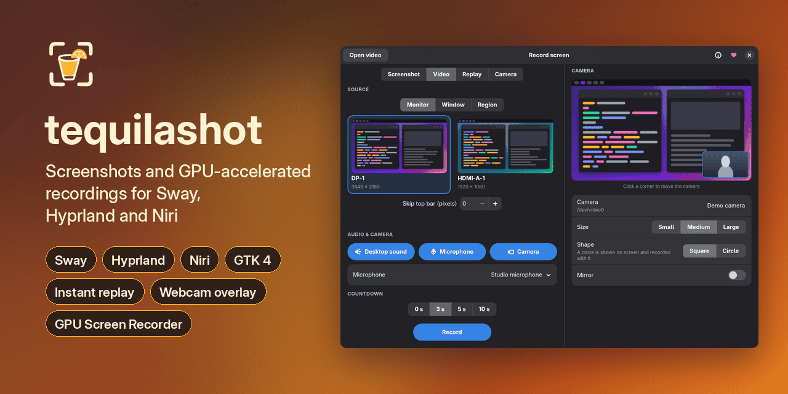
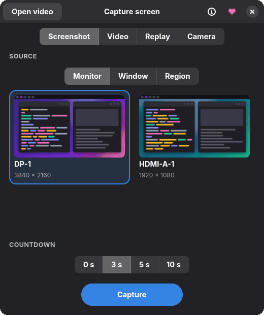
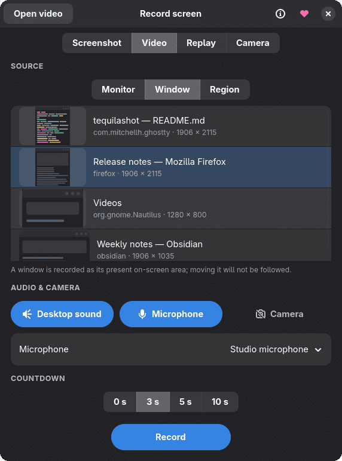
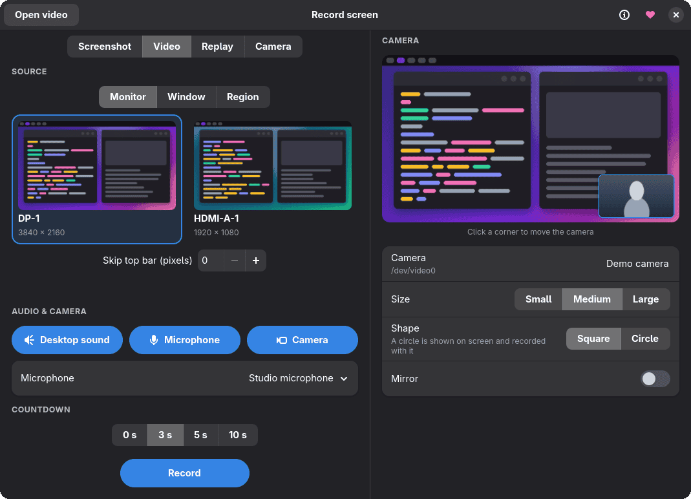
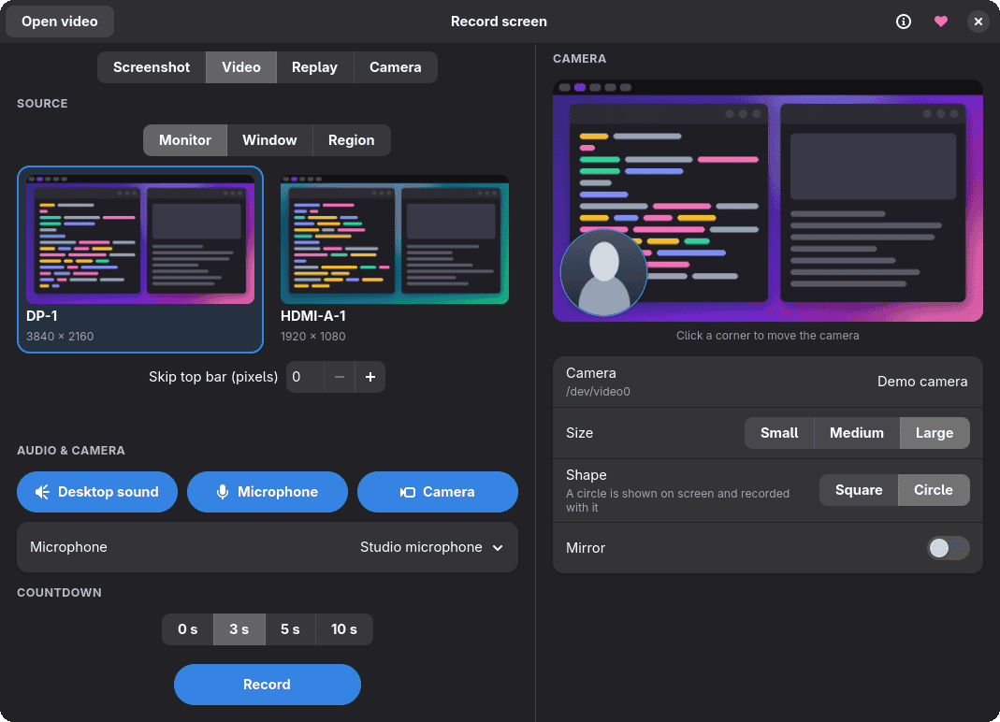
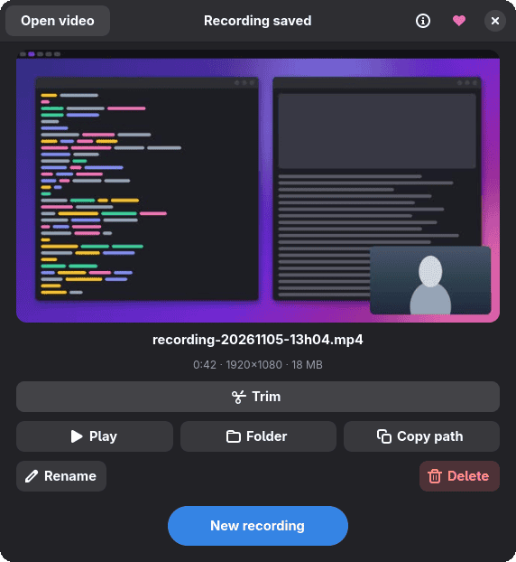
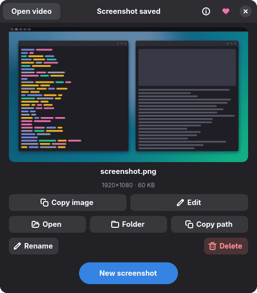
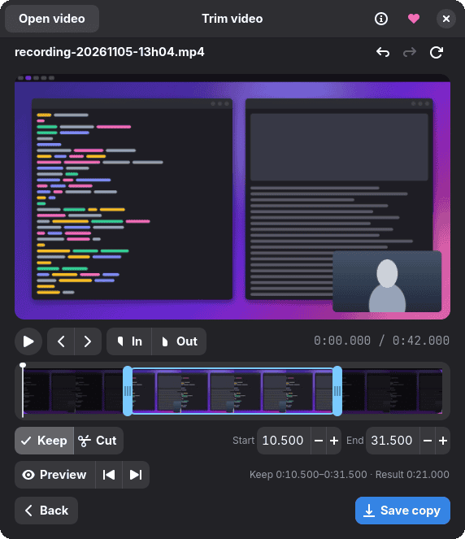

<h1 align="center">
  <picture>
    <source media="(prefers-color-scheme: dark)" srcset="assets/tequilashot-logo-inverse.svg">
    
  </picture>
</h1>

<p align="center">Blazing-fast screenshots, GPU-accelerated screen recordings and instant replay for Sway and Hyprland, in GTK4 or from the command line.</p>

<p align="center">
  
</p>

Run `tequilashot` with no arguments to open the capture dialogue. It starts
the daemon if needed and remembers your last settings. Enter captures, Escape
closes.

- **GPU-accelerated recording.** Video is encoded in hardware on your
  graphics card by GPU Screen Recorder, so the CPU stays free and recordings
  stay smooth, even at high resolutions and frame rates.
- **Instant replay.** Keep the last 30, 60 or 120 seconds of a monitor in
  memory and save the moment after it has happened.
- **Quick to hand.** A resident daemon keeps the dialogue a keystroke away,
  and every capture is a single command for key bindings and Waybar.

## The capture dialogue

### Choose what to capture

<p align="center">
  
  &nbsp;
  
</p>

Pick Screenshot, Video, Replay or Camera, then a source:

- Monitor: live thumbnails of each output.
- Window: open windows with a preview, application and size.
- Region: drag out an area after pressing Capture or Record.

Countdown is 0, 3, 5 or 10 seconds. The dialogue hides before capturing.

### Record with sound and camera

<p align="center">
  
</p>

Video mode adds:

- Desktop sound.
- Microphone, with an input device picker.
- Camera, shown only when a webcam is found. It opens a panel with a live
  preview over the selected source. Click a corner or use the arrow keys to
  place it, and choose Small, Medium or Large, Square or Circle, and mirroring.
- Skip top bar, for monitor recordings: trims pixels from the top of the
  output to hide a bar.

The dialogue hides during the recording. Stop it by running `tequilashot`
again, `tequilashot stop-recording`, or clicking the Waybar module; the
dialogue then shows the result.

A window recording captures the window's area at the time you press Record.
Moving the window afterwards does not move the recorded area.

### Round camera

<p align="center">
  
</p>

GPU Screen Recorder adds the square camera to the video file, so it is not
visible on screen. The Circle shape instead shows the webcam on screen as a
round bubble with a white ring, above other windows, and the recording
captures it from there.

You can drag the bubble around its monitor while recording; keep it inside the
recorded area if you want it in the video. Clicks outside the circle go
through to the windows beneath. The bubble closes when the recording stops
and does not follow a moving window.

It needs a GUI build, [gtk4-layer-shell](https://github.com/wmww/gtk4-layer-shell)
and a layer-shell compositor such as Sway or Hyprland.

#### Removing the background

Switch on Remove background (`--camera-remove-background`) to show only
yourself in the circle. Your surroundings become transparent, so the screen
beneath shows through whilst the white ring stays. It works for the round
camera in recordings and in the virtual camera, and not for the square one.
Add Hide ring (`--camera-no-ring`) to drop the white ring as well.

The segmentation runs on the CPU, so expect a lower frame rate than the plain
camera, roughly six pictures a second on a desktop processor. It is a
person-segmentation model and will occasionally clip hair or hands. Nothing is
downloaded behind your back, but the dialogue offers a Download button for the model. You need:

- [ONNX Runtime](https://onnxruntime.ai/) as a shared library, found in the usual
  system locations or through `TEQUILASHOT_ONNXRUNTIME_LIB`. The Go binding is
  built for version 1.29.
- The `u2net_human_seg.onnx` model (Apache-2.0, from the
  [rembg releases](https://github.com/danielgatis/rembg/releases/tag/v0.0.0)),
  saved as `~/.local/share/tequilashot/u2net_human_seg.onnx` or named by
  `TEQUILASHOT_SEGMENTATION_MODEL`.

If either is missing, or the segmentation fails, the round camera is hidden and
an error is reported instead of showing your real background. A recording or
the virtual camera that is already running carries on without it.

### Virtual camera

Camera mode publishes the chosen monitor, window or region as a webcam that
Google Meet, Chrome and other call applications can select, with your webcam
in a round bubble on top. Press Go live to start it, and run `tequilashot`
again to stop it. See [Virtual camera](#virtual-camera) for the one-off setup.

### Instant replay

Replay keeps the previous 30, 60 or 120 seconds of a selected monitor in RAM,
with optional desktop sound and microphone. The default is 60 seconds. Press
Start buffering, then reopen `tequilashot` to show Save replay and Stop
buffering. Closing the dialogue leaves buffering active.

Save replay writes an MP4 and keeps buffering. The result page offers the
usual playback and file actions; Back to replay returns to the controls.
Saving before the buffer is full keeps the footage available so far. Stop
buffering discards the unsaved buffer and keeps clips already saved.

Replay needs a GPU Screen Recorder build with `-ipc` support. Restart an
existing Tequilashot daemon after upgrading. Replay captures monitors only,
without a webcam overlay. Stop buffering before starting a normal recording;
replay cannot be paused. Buffering does not resume automatically after the
daemon restarts.

Replay targets 20 Mbps H.264, which comes to about 2.5 MB per second of
footage. The bitrate is fixed, so these figures hold whatever the resolution
or refresh rate of the monitor.

| Buffer | Buffered footage |
| --- | --- |
| 30 seconds | about 75 MB |
| 60 seconds (default) | about 150 MB |
| 120 seconds | about 300 MB |

The buffer stays in memory and nothing is written to disk until you save. The
recorder keeps some extra memory of its own for encoding, so allow a little
more than the figures above. Saving writes the clip to the capture folder and
prints its path. Expect a larger clip to take longer, and note that buffering
carries on whilst it runs. You get whatever the buffer held at the moment you
saved, so save after the moment you wanted to keep.

```sh
# Buffer the focused monitor, including desktop sound
tequilashot replay-start --current-screen --seconds 60 --audio
# Save the buffer and print the completed clip's path
tequilashot replay-save
# Discard the remaining buffer
tequilashot replay-stop
```

Without `--current-screen`, the monitor picker opens. `--mic` and
`--mic-device <id>` work as they do for recordings. `--seconds` accepts 30,
60 or 120. Clips use the configured capture folder and its retention rules.
If a save cannot be confirmed, buffering continues; stop and restart replay
before trying another save. Completed exports are recovered when buffering
stops.

### After the capture

<p align="center">
  
  &nbsp;
  
</p>

The result page shows a preview with the file's size and its length,
resolution or dimensions. You can play or open it, show it in its folder, copy
its path, rename it (keeping the extension) or move it to the bin. Screenshots
add Copy image and Edit, which opens [Satty](https://github.com/gabm/satty)
and reloads the preview on save. New recording, New screenshot or Escape goes
back to the setup page.

<p align="center">
  
</p>

Open an existing local video with Open video, or drop one onto the idle window.
Recordings and saved replays also offer Trim. Drag the two timeline handles
to select a section, or enter precise start and end times in seconds.

Keep saves the selected section; Cut removes it and joins the remaining
footage. Preview plays the result before saving, and the icons beside it
preview the first moments of a kept selection, the last moments before its
end, or the join left by a cut. Each short preview stops automatically. Click
the timeline to seek, or step one frame at a time with the chevrons beside
Play. Left and Right also step one frame whilst the video or timeline has
focus; hold Shift to jump one second. In and Out set the selection boundary
at the displayed frame. The timecode beside them follows the playhead. Space
plays or pauses. Undo (Ctrl+Z) and Redo (Ctrl+Shift+Z) restore edits, and the
refresh button restores the full selection. Back or Escape returns to the
previous page.

Save copy creates a uniquely named `-trimmed.mp4` beside the original, which
is kept. Saving shows progress and can be cancelled.

## Install

You can install a package or build from source.

### Build from source

You need Go 1.25.6 or newer, a C toolchain, and the GTK 4 and libadwaita
development files.

```sh
go install github.com/chmouel/tequilashot/cmd/tequilashot@main
```

Or build a local binary:

```sh
make build
bin/tequilashot
```

To build the command-line tools without GTK:

```sh
CGO_ENABLED=0 go build -tags nogui -o bin/tequilashot ./cmd/tequilashot
```

### Prebuilt releases

[GitHub Releases](https://github.com/chmouel/tequilashot/releases) has an
x86_64 archive, deb and rpm packages, all carrying the capture dialogue, a
desktop launcher and the application icon. They need GTK 4 and libadwaita at
run time, and gtk4-layer-shell for the round camera.

Arch Linux users can install the same build from the AUR:

```sh
yay -S tequilashot-bin
```

The aarch64 archive and the apk packages for both architectures carry the
command-line tools only.

### Runtime tools

| Tool | Used for |
| --- | --- |
| [grim](https://sr.ht/~emersion/grim/) | Capturing Wayland output |
| [slurp](https://github.com/emersion/slurp) | Selecting a region |
| [gpu-screen-recorder](https://git.dec05eba.com/gpu-screen-recorder/about/) | Recording video, audio and webcam input |
| [wl-clipboard](https://github.com/bugaevc/wl-clipboard) | Clipboard commands |
| [FFmpeg](https://ffmpeg.org/) | Camera previews, the round camera, recording details and video trimming |

Optional: [gtk4-layer-shell](https://github.com/wmww/gtk4-layer-shell) (round
camera), [Satty](https://github.com/gabm/satty) (editing screenshots),
[aichat](https://github.com/sigoden/aichat) (AI-generated file names).

Desktop notifications require a notification service on the session D-Bus.

Tequilashot leaves the encoder to GPU Screen Recorder. It encodes on the GPU
and does not fall back to the CPU, so hardware H.264 encoding has to work on
the card the recorder selects. If a capture fails as soon as it starts, check
that before anything else.

The [virtual camera](#virtual-camera) also needs
[wf-recorder](https://github.com/ammen99/wf-recorder), plus either the
v4l2loopback kernel module or `gst-launch-1.0` with the GStreamer PipeWire
plugin.

## Command line

The commands use the same daemon as the dialogue and start it when needed.

```sh
# Capture a selected region
tequilashot selection-clipboard
tequilashot selection-file
tequilashot selection-edit

# Capture the focused window or screen
tequilashot current-window-clipboard
tequilashot current-window-file
tequilashot current-screen-clipboard

# Record a selection, screen or focused window
tequilashot movie-selection
tequilashot movie-screen --audio --mic
tequilashot movie-current-window --camera

# Control a recording
tequilashot pause-recording
tequilashot stop-recording
tequilashot toggle-record -a movie-current-window -w 2
```

Recording flags:

- `--audio`: desktop sound.
- `--mic`: default microphone. `--mic-device <id>` picks one from
  `gpu-screen-recorder --list-audio-devices` and implies `--mic`.
- `--camera`, `-C`: webcam. Tune it with `--camera-device`,
  `--camera-position` (`top-left`, `top-right`, `bottom-left`, `bottom-right`),
  `--camera-size` (`small`, `medium`, `large`), `--camera-mirror` and
  `--camera-shape circle` for the [round camera](#round-camera), which also
  accepts `--camera-remove-background`.
- `--crop-top <px>` (screen recordings only): trim pixels from the top.

### Hyprland key bindings

With a Lua configuration (`~/.config/hypr/hyprland.lua`), bind the commands
with `hl.bind` and `hl.dsp.exec_cmd`:

```lua
-- Open the capture dialogue
hl.bind("SUPER + R", hl.dsp.exec_cmd("tequilashot"))
-- Region screenshot to the clipboard
hl.bind("Print", hl.dsp.exec_cmd("tequilashot selection-clipboard"))
-- Region screenshot to a file
hl.bind("SHIFT + Print", hl.dsp.exec_cmd("tequilashot selection-file"))
-- Start or stop a screen recording
hl.bind("SUPER + SHIFT + R", hl.dsp.exec_cmd("tequilashot toggle-record -a movie-screen -w 2"))
-- Start or stop a window recording
hl.bind("SUPER + CTRL + R", hl.dsp.exec_cmd("tequilashot toggle-record -a movie-current-window -w 2"))
-- Pause or resume the recording
hl.bind("SUPER + P", hl.dsp.exec_cmd("tequilashot pause-recording"))
-- Stop the recording
hl.bind("SUPER + S", hl.dsp.exec_cmd("tequilashot stop-recording"))
```

`pause-recording` toggles between pausing and resuming. The dialogue has no
pause button, so use this binding or the command line. Adjust the keys to suit
your setup; Hyprland reloads a Lua configuration when the file is saved, or
run `hyprctl reload`.

### Sway key bindings

Add bindings like these to `~/.config/sway/config`:

```
# Open the capture dialogue
bindsym $mod+r exec tequilashot
# Region screenshot to the clipboard
bindsym Print exec tequilashot selection-clipboard
# Region screenshot to a file
bindsym Shift+Print exec tequilashot selection-file
# Start or stop a screen recording
bindsym $mod+Shift+r exec tequilashot toggle-record -a movie-screen -w 2
# Start or stop a window recording
bindsym $mod+Ctrl+r exec tequilashot toggle-record -a movie-current-window -w 2
# Pause or resume the recording
bindsym $mod+p exec tequilashot pause-recording
# Stop the recording
bindsym $mod+s exec tequilashot stop-recording
```

Adjust the keys to suit your setup, then reload with `swaymsg reload`.

## Virtual camera

`tequilashot virtual-camera` publishes a camera device that Chrome, Google Meet
and other video-call applications can select. It shows a screen at 1280×720 and
30 frames per second, with your webcam in a round bubble on top if you ask for
it.

```sh
tequilashot virtual-camera start --camera
tequilashot virtual-camera start --output DP-1 --camera --camera-position top-right
tequilashot virtual-camera start --selection
tequilashot virtual-camera toggle --current-window
tequilashot virtual-camera stop
```

The focused screen is used unless you pass `--output`, `--selection` or
`--current-window`. The webcam flags match the recording ones, except that the
bubble is always round. While the virtual camera is live, the bubble holds the
webcam, so choose the virtual camera in your call rather than the real one, and
recordings that ask for the webcam are refused. If the shared screen shows the
call itself, you will see an endless mirror.

`--backend` chooses how the picture reaches other applications. `auto`, the
default, uses a v4l2loopback device when one exists and PipeWire otherwise.

v4l2loopback works with every application that reads `/dev/video*`. Install
`v4l2loopback-dkms` and your kernel headers, then load the module:

```sh
sudo modprobe v4l2loopback devices=1 video_nr=10 card_label=tequilashot exclusive_caps=1
```

Chrome lists the device only with `exclusive_caps=1`. To load it at boot, put
`v4l2loopback` in `/etc/modules-load.d/v4l2loopback.conf` and the options in
`/etc/modprobe.d/v4l2loopback.conf`:

```ini
options v4l2loopback devices=1 video_nr=10 card_label=tequilashot exclusive_caps=1
```

The PipeWire backend needs no kernel module and appears as a camera named
`tequilashot`. In Chrome, enable
`chrome://flags/#enable-webrtc-pipewire-camera` first; support in other
applications varies.

To check the picture locally, run
`mpv av://v4l2:/dev/video10 --profile=low-latency --untimed`.

## Configuration

The dialogue stores its settings at
`$XDG_CONFIG_HOME/tequilashot/tequilashot.json`, or
`~/.config/tequilashot/tequilashot.json` when `XDG_CONFIG_HOME` is unset.

Captures go to `~/Downloads/Screenshots` by default. The daemon deletes files
directly in that folder once they are older than three days, at start-up and
then daily. Subfolders, hidden files and symlinks are kept, so move anything
you want to keep, or set a dedicated folder.

| Environment variable | Default | Purpose |
| --- | --- | --- |
| `TEQUILASHOT_SAVE_LOCATION` | `~/Downloads/Screenshots` | Screenshot and recording directory |
| `TEQUILASHOT_AI_MODEL` | `gemini:gemini-2.5-flash-image` | Model used for AI-generated filenames |
| `TEQUILASHOT_WAYBAR_POLL_INTERVAL` | `1s` | Waybar status polling interval; values below `100ms` use `100ms` |

The daemon starts on demand. To start it with your session, install
[`systemd/tequilashot.service`](systemd/tequilashot.service) as a user unit and
fix its `ExecStart` path.

## Waybar

```json
"custom/recording": {
  "exec": "tequilashot waybar-status --follow",
  "on-click": "tequilashot toggle-record -a movie-current-window",
  "return-type": "json"
}
```

While the virtual camera is live, the status uses the `live` class and the
icon set by `--icon-live`.

For replay controls, use a separate module with click to save and right-click
to stop. Start buffering from the dialogue or a key binding first:

```json
"custom/replay": {
  "exec": "tequilashot waybar-status --follow --no-idle-output",
  "on-click": "tequilashot replay-save",
  "on-click-right": "tequilashot replay-stop",
  "return-type": "json"
}
```

Replay uses the `replay` class and `--icon-replay`. The tooltip shows the
monitor and buffer duration. For Sway, bind a save with
`bindsym $mod+F9 exec tequilashot replay-save`; for Hyprland Lua, use
`hl.bind("SUPER + F9", hl.dsp.exec_cmd("tequilashot replay-save"))`.

## Shell completion

Generate completion from the installed command so it includes the available
commands and flags:

```sh
# Bash or Zsh: add the matching line to your shell configuration
source <(tequilashot completion bash)
source <(tequilashot completion zsh)

# Fish
tequilashot completion fish > ~/.config/fish/completions/tequilashot.fish
```

## Sway key bindings

```ini
bindsym $mod+Print exec tequilashot
bindsym Print exec tequilashot selection-clipboard
bindsym Shift+Print exec tequilashot selection-file
bindsym $ctrl+Print exec tequilashot toggle-record -a movie-current-window -w 2
bindsym $ctrl+Shift+Print exec tequilashot stop-recording
```

`$mod+Print` opens the dialogue, or stops a recording started from it.

## Development

See [DEVELOPER.md](DEVELOPER.md) for tests, screenshots, releases and the
daemon socket protocol.

## Author

[](https://github.com/sponsors/chmouel)

### Chmouel Boudjnah

- Fediverse - <[@chmouel@chmouel.com](https://fosstodon.org/@chmouel)>
- Twitter - <[@chmouel](https://twitter.com/chmouel)>
- Blog - <[https://blog.chmouel.com](https://blog.chmouel.com)>

## Licence

[Apache-2.0](./LICENSE)
